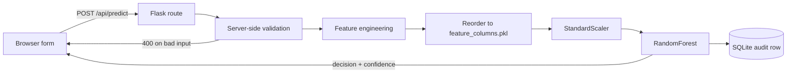
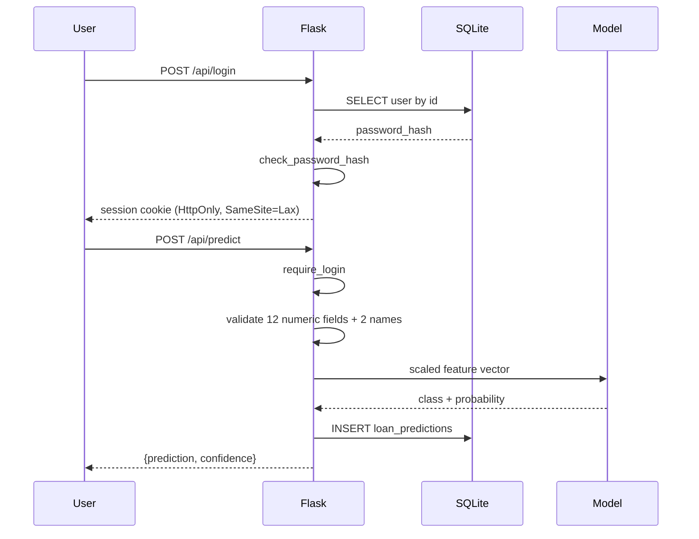

# Loan Eligibility Prediction System

A Flask web application that predicts loan eligibility from an applicant's
financial and demographic details, using a Random Forest trained on the classic
loan-prediction dataset in [data/train.csv](data/train.csv).


> **This is a demonstration project, not a lending system.** Predictions come
> from a model trained on 614 historical records and must not be used to make
> real credit decisions. See [Model honesty](#model-honesty) for what the model
> does and does not actually know.

## Contents

- [Quick start](#quick-start)
- [How it works](#how-it-works)
- [Configuration](#configuration)
- [API](#api)
- [Model honesty](#model-honesty)
- [Testing](#testing)
- [Deployment](#deployment)
- [Project structure](#project-structure)
- [Troubleshooting](#troubleshooting)

## Quick start

Requires **Python 3.11+**.

```bash
git clone https://github.com/aaron-seq/Loan-eligibility-calculator.git
cd Loan-eligibility-calculator

python -m venv .venv
# Windows:
.venv\Scripts\activate
# macOS/Linux:
source .venv/bin/activate

pip install -r requirements.txt
```

**Train the model. This step is required, not optional** — the `.pkl` artefacts
are not committed, and without them `/api/predict` returns `503`:

```bash
python models/model_trainer.py    # ~1-2 minutes (grid search over 162 candidates)
```

Then configure and run:

```bash
cp .env.example .env    # Windows: copy .env.example .env
python app.py
```

The app starts on <http://localhost:5000>. The SQLite database and its tables
are created automatically on first run.

With `FLASK_ENV=development` (the default in `.env.example`) the app seeds an
admin account `admin` / `admin123` and prints a warning. Set `ADMIN_PASSWORD`
to choose your own.

## How it works



The step that matters is **"Reorder to `feature_columns.pkl`"**. The scaler is
fitted on a pandas DataFrame, so scikit-learn validates both the column *names*
and their *order* at `transform()` time. `models/model_trainer.py` persists the
exact training order alongside the model, and `app.py` reindexes to it rather
than hardcoding a list that can silently drift out of sync.

### Request lifecycle



## Configuration

All settings come from environment variables, read from `.env` if present.
See [.env.example](.env.example).

| Variable | Default | Notes |
| --- | --- | --- |
| `FLASK_ENV` | `production` | `development` relaxes the checks below and enables the debugger. |
| `SECRET_KEY` | none | **Required unless `FLASK_ENV=development`.** The app refuses to start without it. |
| `ADMIN_USERNAME` | `admin` | Seeded on first run only. |
| `ADMIN_PASSWORD` | none | Unset → dev seeds `admin123`; production creates **no** admin account. |
| `DATABASE_PATH` | `loan_prediction.db` | Must be in a writable directory. |
| `MODEL_PATH` | `models` | Directory holding the three `.pkl` artefacts. |
| `PORT` | `5000` | |

### Security behaviour

- Passwords are hashed with Werkzeug's PBKDF2; plaintext is never stored.
- Session cookies are `HttpOnly` and `SameSite=Lax`, and `Secure` outside
  development. Sessions expire after 1 hour.
- The session is cleared on login so a pre-login cookie cannot be carried
  across the privilege boundary.
- An unset `SECRET_KEY` in production is a hard startup failure rather than a
  silent fallback to a per-process random key, which would log every user out
  on each restart and give each worker a different key.
- An unset `ADMIN_PASSWORD` in production creates no admin account, rather than
  one with a password published in this README.

## API

| Method | Path | Auth | Purpose |
| --- | --- | --- | --- |
| `GET` | `/api/health` | — | Liveness plus per-dependency status. `503` if degraded. |
| `POST` | `/api/register` | — | Create an account. |
| `POST` | `/api/login` | — | Start a user session. |
| `POST` | `/api/predict` | user | Score a loan application. |
| `POST` | `/api/admin/login` | — | Start an admin session. |
| `GET` | `/dashboard` | user | Prediction form. |
| `GET` | `/admin/dashboard` | admin | All predictions. |
| `GET` | `/logout`, `/admin/logout` | — | End the session. |

All `POST` endpoints accept either JSON or form-encoded bodies.

```bash
curl http://localhost:5000/api/health

curl -X POST http://localhost:5000/api/register \
  -H "Content-Type: application/json" \
  -d '{"user_id":"ada_l","email":"ada@example.com","full_name":"Ada Lovelace",
       "password":"CorrectHorse1","confirm_password":"CorrectHorse1"}'
```

### Validation

Every prediction field is validated server-side; the first failure returns
`400` with a message naming the field. Missing fields are rejected rather than
defaulted, so a blank form cannot produce a confident prediction.

| Field | Accepted |
| --- | --- |
| `first_name`, `last_name` | 1–50 chars, letters/spaces/apostrophes/hyphens |
| `gender`, `married`, `education`, `self_employed` | `0` or `1` |
| `dependents` | `0`–`5` |
| `property_area` | `0` rural, `1` semi-urban, `2` urban |
| `credit_history` | `0.0`–`1.0` |
| `cibil_score` | `300`–`900` |
| `applicant_income` | `1`–`100,000,000` |
| `coapplicant_income` | `0`–`100,000,000` |
| `loan_amount` | `1`–`50,000,000`, and ≤ 50× total monthly income |
| `loan_amount_term` | `1`–`480` months |

Usernames are 3–50 characters of `[a-zA-Z0-9_]`, stored lowercase. Passwords
must be at least 8 characters.

## Model honesty

**Algorithm.** `RandomForestClassifier`, hyperparameters chosen by 5-fold
`GridSearchCV` over 162 candidates. Trained on 614 rows, 22 features.

**Measured performance** on the held-out 20% split (`random_state=42`):

| Metric | Value |
| --- | --- |
| Test accuracy | 0.90 |
| Cross-validated accuracy | 0.80 |
| Precision / recall (approved) | 0.89 / 0.98 |
| Precision / recall (rejected) | 0.93 / 0.74 |

The gap between CV (0.80) and test (0.90) accuracy on a 123-row test set means
the headline number carries real variance — treat 0.80 as the honest estimate.
The model is also much better at confirming approvals than catching rejections.

### The CIBIL score field is synthetic

`data/train.csv` has no CIBIL column. `models/model_trainer.py` fabricates one
with `np.random.randint(300, 850)` — a random number uncorrelated with the
label — and trains on it.

The model did not ignore that noise. It ranks **5th of 22 features** by
importance (0.063), because a continuous random variable offers a Random Forest
many split points to overfit. Sweeping the field with everything else held
fixed:

| CIBIL input | Decision | Confidence |
| --- | --- | --- |
| 300 | APPROVED | 69.35% |
| 500 | APPROVED | 81.21% |
| 800 | APPROVED | 85.33% |
| 900 | APPROVED | 82.19% |

So the field visibly moves the output — by up to 16 percentage points, and
non-monotonically (900 scores *lower* than 800). **That movement encodes
nothing but the training seed's random draw.** A user entering their real CIBIL
score gets a response that looks sensitive to it and is not.

The form also accepts 300–900 while training only covered 300–850, so the top
of the range is outside the model's support entirely.

The field is kept because the form, database schema and feature vector are all
built around it. Removing it, or training on data that contains a real credit
score, both require retraining — neither is a UI-only change.

`Credit_History` (importance 0.282, 4× the next feature) is what genuinely
drives the approve/reject decision, as the sweep above shows: flipping it to
`0.0` turns every one of those rows into a rejection.

## Testing

```bash
pip install pytest pytest-cov
python models/model_trainer.py   # prediction tests skip without artefacts
pytest
```

71 tests covering the feature-order contract, input validation, authentication,
session boundaries, multi-worker startup and configuration. Coverage of
`app.py` is 87%.

Tests that need the trained model skip themselves when the artefacts are
absent, so a fresh clone still runs green.

`test_concurrent_worker_startup` spawns real subprocesses, because the startup
races it guards against are cross-process and do not reproduce in a
single-process loop.

## Deployment

This app keeps state in SQLite, so it needs a host with a **writable,
persistent filesystem**: Railway, Render, Fly.io, or any VM.

### Docker (recommended)

```bash
docker build -t loan-app .

docker run -d -p 8000:8000 \
  -v loan-data:/data \
  -e SECRET_KEY="$(python -c 'import secrets; print(secrets.token_urlsafe(32))')" \
  -e ADMIN_PASSWORD="choose-something" \
  loan-app
```

The build trains the model against the exact pinned library versions in the
image, so the pickles always match the runtime. The named volume at `/data`
holds the database — **without it, every redeploy starts empty.**

`SECRET_KEY` is mandatory; the container refuses to start without it. The image
runs as a non-root user and ships a `HEALTHCHECK` against `/api/health`.

### Buildpack hosts

A `Procfile` is included for Railway, Render and Heroku-style platforms. Its
`release` step trains the model on each deploy. Attach a persistent disk and
point `DATABASE_PATH` at it.

### Bare process

```bash
export SECRET_KEY="$(python -c 'import secrets; print(secrets.token_urlsafe(32))')"
export ADMIN_PASSWORD="choose-something"
export FLASK_ENV=production
python models/model_trainer.py
gunicorn --workers 2 app:app
```

### Why there is no `vercel.json`

It was removed because it could not work. Vercel's Python runtime has a
read-only filesystem outside `/tmp`, so every registration and saved prediction
fails; `/tmp` is per-instance and ephemeral, so anything written there vanishes.
The config also had no build step to produce the model artefacts.

Deploying this app to a serverless platform requires replacing SQLite with a
network-backed database first. Shipping a config that silently loses user data
is worse than shipping none.

### Concurrency

The app runs multi-worker safely. SQLite is opened in WAL mode with a 30s busy
timeout, so readers do not block the writer, and startup is idempotent across
workers — both are covered by `test_concurrent_worker_startup`.

WAL still means **one writer at a time**. That is ample for this workload; a
write-heavy deployment wants a client/server database.

## Project structure

```
Loan-eligibility-calculator/
├── app.py                     # The entire application: routes, validation, prediction
├── requirements.txt
├── pytest.ini
├── Dockerfile                 # Trains the model at build; runs gunicorn as non-root
├── Procfile                   # Buildpack hosts (Railway, Render, Heroku)
├── .env.example
│
├── models/
│   ├── model_trainer.py       # Training pipeline
│   └── *.pkl                  # Generated, git-ignored
│
├── templates/
│   ├── base.html
│   ├── auth/{login,signup}.html
│   ├── dashboard/home.html    # Prediction form
│   └── admin/{login,dashboard}.html
│
├── static/js/common.js
│
├── tests/
│   ├── conftest.py
│   ├── test_auth.py           # Registration, login, session boundaries
│   ├── test_config.py         # Security defaults, health
│   └── test_predict.py        # Feature contract, validation
│
└── data/
    ├── train.csv, test.csv
    └── *.ipynb                # Original exploratory notebooks
```

`app.py` is deliberately a single module. At ~780 lines serving 5 endpoints, it
does not need a service/repository/controller split — a previous attempt at one
is described in the git history.

## Troubleshooting

**`/api/predict` returns 503** — the model artefacts are missing. Run
`python models/model_trainer.py`. Check `/api/health`, which reports
`model_available` and `database_available` separately.

**App exits with `SECRET_KEY environment variable is required`** — expected
outside development. Set `SECRET_KEY`, or set `FLASK_ENV=development` locally.

**Admin login fails in production** — `ADMIN_PASSWORD` was unset on first run,
so no admin account exists. Set it, delete the database file, and restart.

**Model fails to load after upgrading scikit-learn** — pickled models are not
portable across versions. Re-run `python models/model_trainer.py`.

**`database is locked`, or workers dying on boot** — should not happen; the
database opens in WAL mode with a 30s busy timeout and startup is idempotent.
If it does, check that every connection goes through
`get_database_connection()`, which is what applies those settings, and that
`DATABASE_PATH` is not on a network filesystem — SQLite locking is unreliable
over NFS/SMB.

**Data disappears after redeploy** — the database is not on a persistent
volume. With Docker, mount one at `/data`; on a buildpack host, attach a disk
and point `DATABASE_PATH` at it.

**Predictions look wrong after editing the trainer** — if you change the
feature set, re-run the trainer so `feature_columns.pkl` is regenerated.
`app.py` validates its feature set against that file and raises a descriptive
error on mismatch.

## Contributing

1. Branch from `main`.
2. Keep `pytest` green; add tests alongside behaviour changes.
3. Follow PEP 8 and the existing structure.

## License

MIT — see [LICENSE](LICENSE).

Built by Aaron Sequeira.
