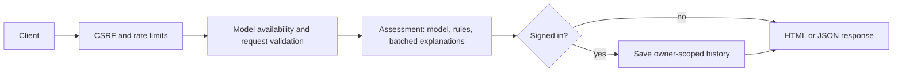

# Architecture

The Flask app separates HTTP handling, assessment logic and persistence. Operational commands live in [deployment](DEPLOYMENT.md); measured results live in the [model card](MODEL.md) and [benchmarks](BENCHMARKS.md).

## Building the stylesheet

The committed CSS supports offline first use. After template classes or
`static/src/tailwind.css` change, activate the development environment and run:

```powershell
$env:TAILWINDCSS_VERSION = 'v3.4.19'
python -m pytailwindcss -i static/src/tailwind.css -o static/css/app.css --content './templates/**/*.html' --minify
```

POSIX shells can use `export TAILWINDCSS_VERSION=v3.4.19` or `make css`.
CI requires an identical rebuild. Native progress elements avoid inline styles,
allowing CSP to reject inline scripts/styles.

## The one rule

**Training and serving use `loanapp/features.py`.** The trainer and assessor
share eleven feature names/order and input transforms. The bundle stores this
contract; the loader rejects a mismatch instead of scoring a different vector.

### The second contract: library versions

The bundle records scikit-learn and NumPy versions. The loader's local policy
compares major/minor versions and permits patch drift; this is not an upstream
compatibility guarantee. Scikit-learn [requires matching dependencies for persistence](https://scikit-learn.org/stable/model_persistence.html).
Keep exact pins and retrain/test after ML dependency changes.

### The third contract: feature parameters

The bundle's recorded training rate supplies model features.
`ANNUAL_INTEREST_RATE` changes displayed affordability and rules only; changing
it must not shift the model input distribution. `TestFeatureRateContract` in
[test_assessment.py](../tests/test_assessment.py) verifies this separation.

## Layers

| Layer | Responsibility |
|---|---|
| `blueprints/` | HTML/JSON routes and authorization |
| `schemas.py` | Pydantic request shape/range validation |
| `assessment.py` | Coordinates `features.py`, `rules.py` and `explain.py` |
| `ml/registry.py` | Loads trusted bundles and checks contracts |
| `db.py` | Parameterized repositories and transactional migrations |

The domain layer has no Flask dependency. `create_app()` constructs one assessor
per worker; it holds no request state.

### How one assessment flows



Unavailable models return 503 before input validation. Invalid request shapes
return controlled 4xx. Cookie-free assessment/compare calls work anonymously;
cookie-bearing mutations require CSRF. Supported scenarios receive estimates;
unsupported ones return null/unavailable and retain rules. See [API contracts](API.md).

### Train and serve: where each contract is enforced

`python -m loanapp.ml.train` maps CSV rows through shared features, compares
candidates with repeated stratified CV, screens sampled loan-amount monotonicity
and selects sigmoid calibration using paired training CV Brier loss. Preprocessing
is fitted inside folds; the separate holdout does not select calibration. The
serving estimator is then refitted on all rows.

`load_bundle()` checks feature/library contracts. Missing, incompatible or
unreadable bundles leave other app features available; [health](DEPLOYMENT.md#health)
reports `unavailable`, `contract_mismatch` or `load_failed`.

### Deployment

Each Gunicorn worker loads its own model and shares a local SQLite WAL volume.
Worker count trades throughput for memory; measure on the target host rather
than extrapolating laptop benchmarks. Use [deployment/scaling guidance](DEPLOYMENT.md#scaling).

### Where validation lives, and where it does not

Schemas reject malformed/impossible inputs. Rules assess valid but financially
unwise inputs, such as an instalment consuming most income. Validation errors
and affordability warnings therefore remain distinct.

## Design decisions worth knowing

These choices define current behavior; changing them requires contract and regression review.

### The model is not the whole answer

Probability, deterministic rules and explanations are separate outputs. An
approval-history classifier is decision support, not a loan offer or repayment-risk model.

### The credit score is in the rules, not the model

The CSV has no bureau score. Optional CIBIL input affects published rules only;
no synthetic bureau score is invented for training.

### Gender and marital status are not collected

Neither enters the form/model features. Training reports exclusion and group
outcome diagnostics in the [model card](MODEL.md#fairness-audit). Correlated
features can retain bias; exclusion does not establish fairness or compliance.

### The model must be monotonic in loan amount

Candidates with material reversals in the sampled loan-amount screen are
ineligible regardless of AUC, because guidance must not recommend a smaller
loan that scores worse. The screen is finite and does not prove global monotonicity.

### Explanations attribute to inputs, not features

Input ablation replaces one applicant-visible input with its training baseline
and recomputes all derived features. Counterfactuals therefore remain coherent.
Scoring batches reduce model calls; see [benchmarks](BENCHMARKS.md).
Contributions ignore interactions and do not sum to the probability; [#25](https://github.com/aaron-seq/Loan-eligibility-calculator/issues/25)
tracks Shapley attribution.

### Storage is JSON-plus-indexed-columns

Saved payloads/assessments retain the historical result rather than silently
rescoring it. Owner, nullable probability, band, model version and timestamp
columns support queries. [Schema v2](DEPLOYMENT.md#schema-v2-upgrade) removes
unsupported model claims transactionally while preserving supported history.

### CSRF is skipped for cookie-less requests

Anonymous assessment/compare calls carry no ambient identity. A global
`before_request` hook protects cookie-bearing mutations and always protects
registration/login forms; new routes inherit the policy. See [API CSRF rules](API.md#csrf).

## Known trade-offs

| Choice | Remaining cost / rationale |
|---|---|
| SQLite and process-local rate limits | One writer and roughly N times the configured limit across N workers; [roadmap](ROADMAP.md) tracks shared storage |
| Committed bundle plus build-time training | Clone-and-run and image/library compatibility, at the cost of binary Git history and training time |
| WAL initialized once | Avoids per-connection journal-mode locks; startup/concurrency tests cover selected races |
| Exact dependency pins | Manual upgrades; weekly dependency auditing and bundle checks detect known issues |

## Adding a feature to the model

1. Update `FEATURE_COLUMNS` and `engineer()` together; map CSV values in `from_training_row()`.
2. Add applicant-visible inputs to `EXPLAINABLE_INPUTS` and `INPUT_LABELS`.
3. Run `python -m loanapp.ml.train`; inspect calibration, monotonicity and fairness diagnostics.
4. Run the [verification commands](../README.md#development-and-verification); commit the bundle, metrics and generated card together.

Repeat training and verification after ML dependency changes. Never load an
untrusted joblib artifact: deserialization can execute code.
