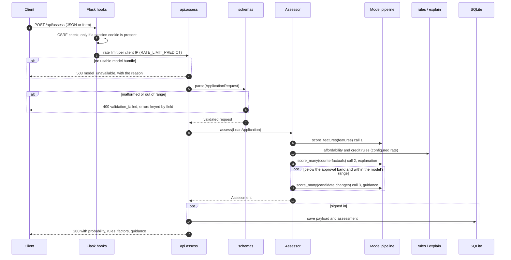
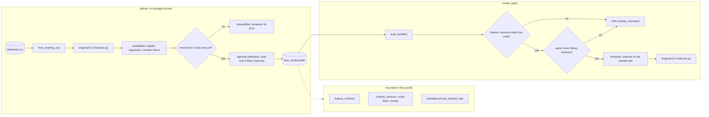
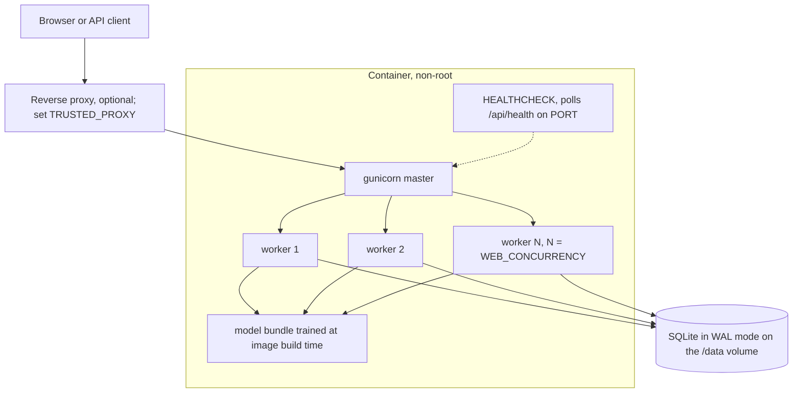

# Architecture

Why the code is shaped the way it is. Read this before making a structural
change.

## The one rule

**Training and serving import the same feature-engineering code.**

Everything else here is ordinary Flask. This one constraint is what the whole
package layout exists to protect, because violating it is what broke the
previous version: feature engineering was implemented twice — once in
`models/model_trainer.py`, once in `app.py` — in two different column orders,
with nothing comparing them. Prediction could not work, and nothing in the
repository would have told you.

```
loanapp/features.py
    ├── imported by loanapp/ml/train.py       (training)
    └── imported by loanapp/assessment.py     (serving)
```

The contract is additionally **persisted inside the model bundle** and
**re-checked at load time**. Changing `FEATURE_COLUMNS` without retraining makes
the app start in a degraded state and return an explanatory 503 — it never
scores a mis-aligned vector.

### The second contract: library versions

The bundle also records the scikit-learn and numpy versions it was pickled
under, and `load_bundle` checks them the same way.

This was added after hitting the failure during a dependency upgrade. A bundle
trained under scikit-learn 1.5 loads into 1.9 without complaint and then raises
`AttributeError: 'SimpleImputer' object has no attribute '_fill_dtype'` inside
`predict` — a 500 on every request, with the only clue a warning on stderr at
startup. scikit-learn documents that pickles are not portable across versions;
the guard turns that from a runtime surprise into a startup refusal with a
message naming both versions and the remedy.

The check compares *minor* versions. Refusing to load across a patch release
would turn a security patch into an outage, and patch releases do not change
pickle layout.

### The third contract: feature parameters

The interest rate has two jobs. It computes `emi_to_income_ratio`, a **model
feature**, and it drives the affordability figures shown to the applicant, a
**business setting**. Serving used to compute both from
`ANNUAL_INTEREST_RATE`, so changing that setting silently changed what the
model was being fed: one application moved from 0.563 to 0.400 with nothing
else touched.

The trainer records the rate it used in the bundle, and `Assessor.feature_rate`
reads it from there. The configured rate now changes only what the applicant
sees. `tests/test_assessment.py::TestFeatureRateContract` holds the line.

## Layers

```
   HTTP
     │
     ▼
┌─────────────────────────────────────────────────────────────┐
│ blueprints/    pages · auth · api · admin                   │  HTTP only
│                No business logic. Renders HTML or JSON.     │
└─────────────────────────────────────────────────────────────┘
     │
     ▼
┌─────────────────────────────────────────────────────────────┐
│ schemas.py     pydantic v2 validation → LoanApplication     │  Shape + range
└─────────────────────────────────────────────────────────────┘
     │
     ▼
┌─────────────────────────────────────────────────────────────┐
│ assessment.py  Orchestrates one assessment                  │  Domain
│   ├── features.py   engineer the model input                │
│   ├── rules.py      deterministic affordability + credit    │
│   └── explain.py    factor attribution + what-if guidance   │
└─────────────────────────────────────────────────────────────┘
     │
     ▼
┌─────────────────────────────────────────────────────────────┐
│ ml/registry.py  bundle load + contract guard                │  Model
│ db.py           repositories                                │  Storage
└─────────────────────────────────────────────────────────────┘
```

The domain layer has no Flask imports. `Assessor` is constructed once at startup
and holds no per-request state, so it can be used from a script, a notebook or a
test without an application context — and `tests/test_assessment.py` does
exactly that.

### How one assessment flows

`POST /api/assess`, end to end. The order is deliberate: model availability is
checked before input validation, so a broken deployment answers 503 to every
caller rather than 400 to some of them. A full assessment makes **three** model
calls, each scoring a batch — see [`BENCHMARKS.md`](BENCHMARKS.md) for why that
took it from 160 ms to 33 ms.



### Train and serve: where each contract is enforced

The trainer and the server import the same feature code, and the bundle
carries everything needed to check that what was trained is what is served.
Each of the three contracts was added after a real failure; the sections
above describe each one.



Anything else the loader can raise, such as a truncated pickle, degrades to
`load_failed` rather than crashing the worker. Both states keep the rest of the
application running and are reported on `GET /api/health`.

### Deployment



Set `WEB_CONCURRENCY` to the CPU count: scoring is CPU-bound and holds the
GIL, so throughput scales with processes, not threads. Each worker loads its
own copy of the model. SQLite's single writer is the first limit to hit;
[`DEPLOYMENT.md`](DEPLOYMENT.md) lists when to move to Postgres.

### Where validation lives, and where it does not

`schemas.py` rejects input that is *malformed or impossible*: a negative loan
amount, a 600-month term, a property area that is not one of three values.

`rules.py` handles input that is *valid but unwise*: an instalment consuming 80%
of income is a perfectly well-formed application, and answering it with a 400
error would be useless. It is assessed, explained, and flagged.

The split matters: a 400 says "you made a mistake", a rule says "here is what
this means for you".

## Design decisions worth knowing

### The model is not the whole answer

An assessment reports three things side by side rather than collapsing them:

1. **Model probability** — statistical, learned from 614 rows, with its accuracy
   attached.
2. **Rules** — deterministic, published thresholds, reproducible by hand.
3. **Explanation and guidance** — why, and what would change it.

Collapsing these into a single `APPROVED` / `REJECTED` would imply an authority
a 0.80-AUC model trained on a few hundred rows does not have. It is also less
useful: "unlikely, because your instalment is 62% of income, and borrowing 20%
less would take you to 61%" is actionable in a way a binary label is not.

### The credit score is in the rules, not the model

The training dataset has no credit bureau score. The previous trainer
manufactured one with `np.random.randint(300, 850)` and trained on it while the
interface presented it as a headline feature — the model could only learn noise.

The score is now collected and used exclusively in `rules.py`, with thresholds
published in the code, in the model card, and on the user-facing page. This is
strictly more honest and strictly more useful, because the effect is now
knowable.

### Gender and marital status are not collected

ECOA / Regulation B prohibits using them as a basis for a credit decision. The
form does not ask, and the model never sees them. Training measures the cost of
the exclusion and writes it into the model card; on this dataset it is
approximately zero (it slightly *helps*).

Excluding an attribute from the inputs does not guarantee parity in the outputs —
correlated features can reintroduce it — so training also runs a fairness audit
over the holdout and publishes the group approval rates.

### The model must be monotonic in loan amount

The product answers "what would improve my chances?". If a smaller loan can
score worse, that advice is wrong. Ranking metrics do not test this.

Training screens every candidate by sweeping the requested amount across three
orders of magnitude and counting reversals; non-monotonic candidates are
disqualified regardless of AUC. This caught a random forest with a respectable
0.83 holdout AUC that scored a 70%-smaller loan below a 50%-smaller one.

It also drove a feature change: a raw `log(loan_amount)` term correlates 0.67
with log income and carries a "bigger loans went to better applicants" effect
that inverts the needed direction. Removing it cost 0.0009 ROC-AUC and made the
model strictly monotonic.

### Explanations attribute to inputs, not features

`loan_amount` drives both the loan-to-income and the instalment-to-income ratio.
Perturbing engineered features independently produces counterfactuals that are
not real applications, and it showed immediately in the UI: one version reported
that a large loan amount *helped* the applicant while loan-to-income *hurt*
them, from the same application.

Attribution therefore varies one **applicant-visible input** at a time and
re-scores the whole application, so every counterfactual is coherent.

The method is one-at-a-time ablation — model-agnostic, deterministic, nine extra
scores. It ignores interactions and does not sum exactly to the total. Both
limits are stated in the model card and on the result page. Upgrading to Shapley
values is on the roadmap.

### Storage is JSON-plus-indexed-columns

`applications` stores the canonical payload and the full assessment as JSON, plus
the handful of columns worth indexing (`user_id`, `probability`, `band`,
`model_version`, `created_at`).

The previous schema mirrored 15 model inputs into 15 columns, which made every
feature-set change a migration. It also means a saved assessment is preserved
*as it was* — history shows what the applicant was told at the time, not a
silent re-score against a newer model.

### CSRF is skipped for cookie-less requests

CSRF is an attack on ambient credentials. A request carrying no session cookie
has none to abuse, so anonymous API calls work with plain `curl`. Every request
that acts on behalf of a signed-in user carries the cookie and is checked.

The check is a `before_request` hook rather than a per-route decorator, so a new
endpoint is protected by default rather than by remembering.

## Known trade-offs

| Choice | Cost | Why it is acceptable here |
|---|---|---|
| SQLite | Single-writer; no horizontal scale | Right for one container at this traffic. `docs/DEPLOYMENT.md` states the migration trigger. |
| In-memory rate limiting | N workers ⇒ N× the limit | Blocks casual abuse with no infrastructure. Interface matches what a Redis backend would implement. |
| Hand-rolled CSRF | Code to maintain | ~40 lines, directly tested, avoids a WTForms dependency tree. |
| Tailwind from CDN | Needs network; unstyled offline | Zero build toolchain. A built stylesheet is a roadmap item. |
| One-at-a-time attribution | Misses interactions | Exact, cheap, no extra dependency. Stated plainly rather than sold as SHAP. |
| Calibrated probability has a ~0.20 floor | No number for extreme inputs | Platt scaling extrapolates to its asymptote outside the training range. Rather than quote an unreachable floor, the app flags the application as out of range and leads with the rules. |
| Model loaded per worker | Memory × workers | ~15 MB for a calibrated linear model. Would matter for a large ensemble. |
| Exact dependency pins | Manual upgrades | The bundle is a pickle, so scikit-learn and numpy are part of the artifact contract. `pip-audit` runs weekly in CI so the pins cannot rot unnoticed. |
| Bundle committed *and* trained in the Docker build | A binary in git, plus ~30s of build time | The committed bundle makes clone-and-run work and lets CI verify the contract; the build-time train guarantees the image's artifact matches the image's libraries. Each covers the other's weakness. |
| WAL set once at init, not per connection | `initialise` must run before first use | A journal-mode switch needs an exclusive lock and SQLite does not reliably invoke the busy handler for it. Ported from `main`; see `tests/test_concurrency.py` for the honest limits of the test coverage. |

## Adding a feature to the model

1. Add the column to `FEATURE_COLUMNS` **and** compute it in `engineer()` —
   the same function, so training and serving move together.
2. Map it from the CSV in `from_training_row()` if it exists in the source data.
3. If it is applicant-visible, add it to `EXPLAINABLE_INPUTS` and `INPUT_LABELS`
   so it appears in explanations.
4. `make train`. The monotonicity screen and the fairness audit run
   automatically; the model card regenerates.
5. `make test`. `test_registry.py` fails if you commit a contract change without
   the retrained bundle.

The same step 4-5 applies to a scikit-learn or numpy upgrade, for the same
reason: the bundle is a pickle whose library versions are part of its contract.
